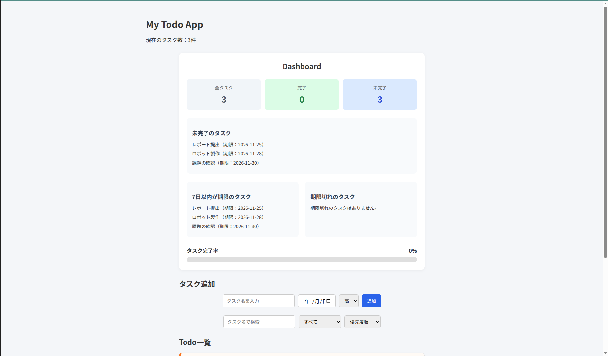
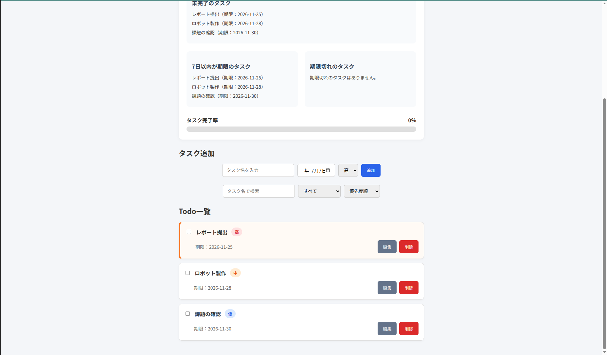
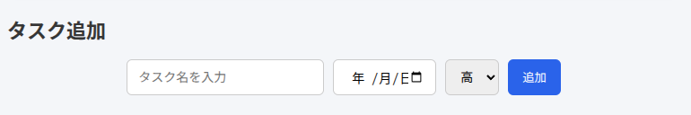
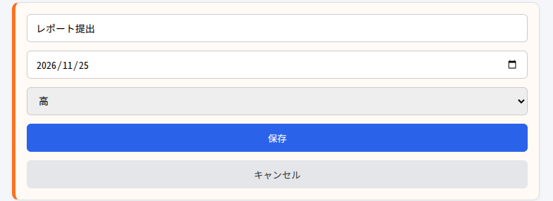
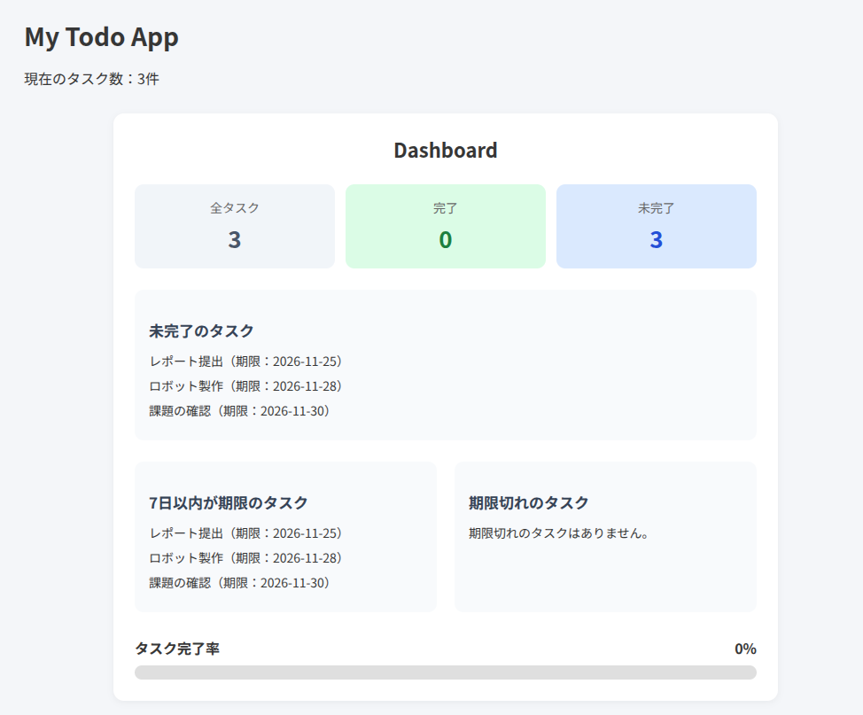
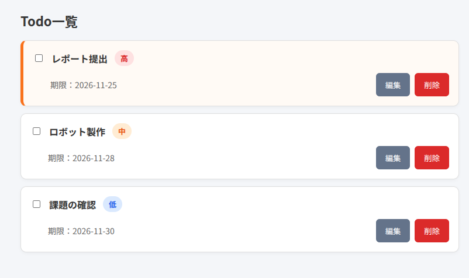

# MyToDo_App

**日々のタスクを整理し、期限と優先度を意識して管理するTodoアプリです。**

<https://zassou-robo.github.io/MyToDo_App/>

タスクの登録・編集・削除といった基本的な管理機能に加え、検索や並び替え、進捗状況を確認できるダッシュボードを実装しています。

PC・スマートフォンの両方から利用でき、タスクの状況を直感的に把握できることを目指しました。

### 1. メイン画面





タスク一覧とダッシュボードを表示するメイン画面です。

### 2. タスクの追加



タスク名・優先度・期限を設定して、新しいタスクを登録できます。

### 3. タスクの編集



登録済みのタスクについて、内容・期限・優先度を変更できます。

### 4. 検索・絞り込み・並び替え


タスク名での検索や、完了状態・優先度・期限に応じた管理ができます。

### 5. ダッシュボード



タスクの総数、完了数、未完了数、完了率などを確認できます。

### 6. Todoの一覧表示


タイトル、優先度、期限をカードで管理しています。
期限の近さで色分けしています。

## 主な機能

### タスク管理
- タスクの追加
- タスクの編集
- タスクの削除
- 完了・未完了の切り替え
- 優先度の設定（高・中・低）
- 期限の設定
- 入力内容のチェック

### 検索・並び替え
- タスク名による検索
- 完了・未完了による絞り込み
- 優先度による並び替え
- 期限による並び替え
- 登録順による並び替え

### ダッシュボード
- 全タスク数・完了数・未完了数の表示
- タスク完了率の表示
- 優先度の高い未完了タスク数の表示
- 7日以内が期限のタスクの表示
- 期限切れタスクの表示

### その他
- LocalStorageによるタスクデータの保存
- 期限に応じたタスクの色分け
- 完了済みタスクの視覚的な区別
- PC・スマートフォンに対応したレスポンシブデザイン

## 工夫した点

### 期限と優先度を意識したタスク管理

タスクに優先度と期限を設定できるようにしました。

さらに、期限が近いタスクや期限切れのタスクを色分けすることで、対応が必要なタスクを見つけやすくしています。

### ダッシュボードによる進捗の可視化

タスクの総数や完了率などをまとめて表示するダッシュボードを実装しました。

また、期限が7日以内のタスクや期限切れのタスクを一覧表示することで、今後取り組むべきタスクを把握しやすくしました。

### データの永続化

LocalStorageを利用し、ブラウザを再読み込みしてもタスクの情報が保持されるようにしました。

### コンポーネントによる機能の分割

Reactのコンポーネントを利用して、ヘッダー・タスク項目・ダッシュボードなどに機能を分割しました。

各コンポーネントに必要なデータや関数をPropsとして渡すことで、役割を分けた構成にしています。

## 使用技術

| 技術 | 用途 |
|---|---|
| React | UIの構築 |
| TypeScript | 型定義・型安全な開発 |
| Vite | 開発環境・ビルド |
| HTML | ページ構造 |
| CSS | デザイン・レスポンシブ対応 |
| LocalStorage | タスクデータの保存 |
| Git / GitHub | ソースコード管理 |
| GitHub Pages | アプリの公開 |
| GitHub Actions | ビルド・自動デプロイ |

## 開発環境

- Node.js
- npm
- Visual Studio Code

## ローカルでの起動方法

### 1. リポジトリをクローン

```bash
git clone https://github.com/zassou-robo/MyToDo_App.git
cd MyToDo_App
```

### 2. 依存パッケージをインストール

```bash
npm install
```

### 3. 開発サーバーを起動

```bash
npm run dev
```

表示されたURLをブラウザで開くと、アプリを利用できます。

### 4. ビルド

```bash
npm run build
```

本番環境向けのファイルが `dist` ディレクトリに生成されます。

## デプロイ

GitHub PagesとGitHub Actionsを利用しています。

`main` ブランチに変更をPushすると、自動的にビルドとデプロイが実行されます。

**公開URL**

<https://zassou-robo.github.io/MyToDo_App/>

**GitHubリポジトリ**

<https://github.com/zassou-robo/MyToDo_App>

## 開発期間・開発時間

- 開発期間：2026.10.31 ～ 2026.11.24
- 開発時間：約24時間